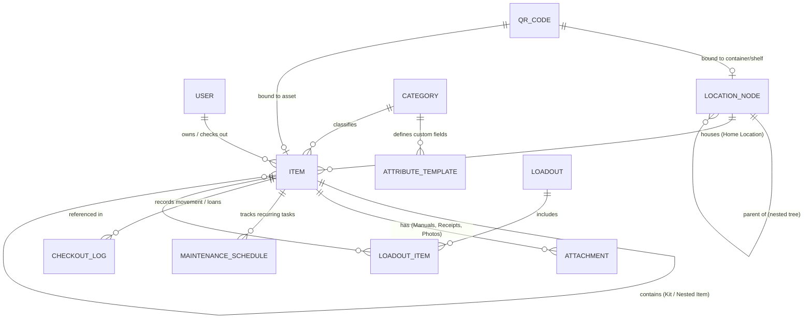
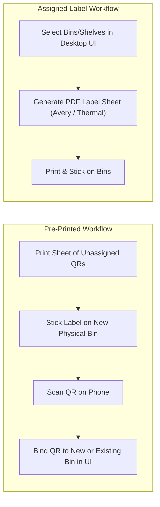
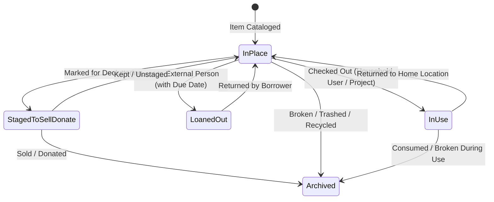
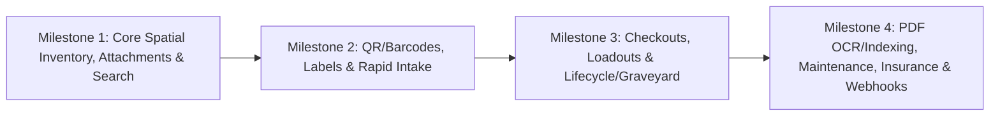

# Product Requirements Document (PRD): WhereHouse

WhereHouse is an open-source application designed for home inventory. Organize and sort everything you own. Track where you put things and create labels for them. Need to find something? Search for it and have it tell you what room and/or box it is in. Want to know what is in a box? Scan the QR code you generated and printed for it and look up what is in the box. Keep track of maintenance reminders, notes, and more.

> [!NOTE]
> **Document Scope:** This PRD defines the functional requirements, domain model, user workflows, and business logic for **WhereHouse**—a self-hosted home inventory, spatial locator, and asset lifecycle management application designed for deployment on TrueNAS Scale.

---

## 1. Executive Summary & Product Vision

**WhereHouse** solves the classic household problem: *"I know I own this item, I know it's somewhere in this house, but which bin or closet is it in—or did we get rid of it?"*

Most home inventory systems fail within weeks of setup due to **cataloging fatigue** (taking too long to add items on Day 1) and **inventory decay** (taking an item out of a bin and failing to record its movement because the UI requires too many clicks). WhereHouse is designed around **zero-friction mobile scanning**, **movable physical containers**, **reusable project loadouts**, and a **full asset lifecycle vault** (from purchase receipt and warranty tracking to decluttering and archival).

### Core Product Pillars
1. **Spatial & Visual Wayfinding:** Know not only *which* room and shelf an item is on, but *what the physical container looks like* before walking into the garage.
2. **Camera-First Speed:** Native mobile browser QR/barcode scanning (enabled via local HTTPS) for instant "X-Ray" bin inspection, rapid batch intake, 1-tap checkouts, and bulk shelf auditing.
3. **Permanent Home vs. Real-Time State:** Every item has a canonical "Home Location" alongside its real-time state (`In Place`, `In Use`, `Loaned Out`, `Staged to Sell/Donate`, or `Archived/Graveyard`).
4. **Complete Ownership Vault:** Centralize manuals (with full-text PDF search), receipts, warranty/return deadlines, recurring maintenance schedules, and 1-click home insurance claim exports.

---

## 2. Target Users & Usage Context

| Persona / Role | Primary Devices | Key Workflows |
| :--- | :--- | :--- |
| **Household Admin / Organizer** | **Desktop Browser** & **Mobile (PWA/Web)** | Designing room/shelf hierarchies, generating & printing QR label sheets, bulk CSV/JSON import, insurance exports, managing household users, and running rapid-fire intake. |
| **Household Member** | **Mobile Phone** & **Desktop Browser** | Searching for items ("Where is the camping stove?"), scanning bin QR codes, checking out tools or project loadouts, and returning items to their home bins. |

> [!IMPORTANT]
> **Operating Environment Assumption:** WhereHouse will run in Docker on TrueNAS Scale and be served on the local network via Nginx Proxy Manager with a custom domain and valid TLS certificate (HTTPS). This guarantees full browser access to `navigator.mediaDevices.getUserMedia` for mobile camera QR/barcode scanning without browser security warnings.

---

## 3. Domain Model & Core Entities

---

## 4. Functional Requirements & Business Logic

### 4.1 Spatial Hierarchy & Movable Containers

#### 4.1.1 Flexible Nested Tree
- Locations are modeled as a self-referencing tree (`parentId`) supporting arbitrary depth (e.g., `House -> Garage -> West Wall Rack -> Shelf 3 -> Bin 042 -> Small Parts Organizer`).
- Every node in the tree has a **Node Type**:
  - **Fixed Location:** Rooms, closets, cabinets, shelving units, specific shelves, drawers, or zones.
  - **Movable Container:** Totes, bins, toolboxes, bags, cases, or caddies.

#### 4.1.2 Container Relocation Inheritance
- Moving a **Movable Container** to a new parent node (e.g., moving `Winter Camping Bin #4` from `Garage Shelf 2` to `Basement Under-Stairs`) updates only the container's `parentId`.
- All items and sub-containers inside that bin automatically resolve their new full path (`House > Basement > Under-Stairs > Winter Camping Bin #4`) without requiring item-by-item edits.

#### 4.1.3 Container Visual Appearance Tags
- To solve the *"Which bin on the shelf is BIN-042?"* problem, Movable Containers support structured visual metadata:
  - **Container Style/Form Factor:** e.g., `27-Gal Heavy Duty Tote`, `Clear Shoebox`, `Cardboard Box`, `Pelican Case`, `Fabric Cube`, `Tool Chest Drawer`.
  - **Color Profile:** Primary body color + lid/accent color (e.g., `Black Base / Yellow Lid`, `Translucent / Blue Latches`), rendered as a visual color badge in the UI.
  - **Cover Photo:** Optional photo of the physical container or its position on the shelf.

---

### 4.2 Item Typology, Granularity & Custom Attributes

#### 4.2.1 Four Item Archetypes
1. **Unique Tracked Assets (1-of-1):**
   - Individual serialized or distinct items (e.g., *DeWalt 20V Hammer Drill*, *Garmin InReach*).
   - Supports serial number, model number, brand, purchase price, replacement value, condition, warranty/return dates, and individual checkout tracking.
2. **Quantity / Stackable Items (Consumables & Bulk Spares):**
   - Tracked by integer or decimal quantity and unit of measure (e.g., *6ft HDMI 2.1 Cable — Qty: 4*, *AA Alkaline Batteries — Qty: 24*, *M3x10 Hex Screws — Qty: 100*).
   - **Low-Stock Threshold:** Optional `minQuantity` integer. When `currentQuantity <= minQuantity`, the item is automatically flagged as **Low Stock** on the Action Center Dashboard.
   - Supports quick `+1` / `-1` / `Set Qty` actions directly from search results and bin views.
3. **Kits & Bundles:**
   - A parent item representing a cohesive kit (e.g., *Electronics Soldering Kit*, *Guest Air Mattress Set*) linked to member child items.
   - **Kit Business Logic:** Checking out a Kit automatically checks out all child items.
   - **Incomplete Kit Warning:** If any child item in the kit is currently `Broken`, `Loaned Out`, `In Use` elsewhere, or below required quantity, attempting to view or check out the Kit displays a high-visibility warning detailing which component is missing or unavailable.
4. **Nested Items (Parent-Child Equipment Relationships):**
   - Allows linking accessories or modular parts directly to a primary asset (e.g., a *Sony A7IV Camera Body* linked to compatible *E-Mount Lenses*, *NP-FZ100 Batteries*, and *Cage Rig*) so users can see all associated gear on the parent item's detail page even if stored in adjacent dividers.

#### 4.2.2 Category Attribute Templates
- Users can define hierarchical or flat **Categories** (e.g., `Cables & Adapters`, `Power Tools`, `Camping Gear`, `Networking`, `Fasteners`).
- Each Category can define an **Attribute Template** of typed custom fields (`text`, `number` with unit, `enum/select`, `boolean`):
  - *Example (`Cables`):* `Connector A` (Enum: USB-C, HDMI, DisplayPort, RJ45...), `Connector B`, `Length (ft)` (Number), `Specification` (Text: HDMI 2.1, Cat6a, USB4).
  - *Example (`Power Tools`):* `Power Source` (Battery, Corded, Pneumatic), `Battery Platform` (DeWalt 20V, Milwaukee M18, Ryobi 18V).
- These structured attributes are indexable and filterable in Smart Search.

---

### 4.3 QR Codes, Barcodes & Label Printing System

#### 4.3.1 Identifiers & QR Encoding
- Every Location, Container, and Item receives a human-readable short code (e.g., `LOC-005`, `BIN-042`, `ITM-1049`) alongside its UUID.
- QR codes can encode either a direct deep-link URL (`https://wherehouse.yourdomain.lan/scan/BIN-042`) for instant native phone camera opening, or compact token strings parsed by the in-app scanner.

#### 4.3.2 Pre-Printed "Blank QR" Sticker Binding
- Users can generate and print a batch of **Unassigned QR Codes** ahead of time to keep next to a label maker or in a tool drawer.
- When organizing in the garage, the user slaps an unassigned sticker onto a physical tote, scans it with their phone, and WhereHouse prompts: *"Unassigned QR scanned! Create a new Container/Item or link to an existing one?"*

#### 4.3.3 Built-In Label Sheet Generator
- Generates print-ready PDFs directly in the browser:
  - **Sheet Layouts:** Standard Avery multi-label sheets (e.g., Avery 5160, 5163, 22806 square QR labels) with a **"Start at Row/Column" offset selector** so partially used sticker sheets aren't wasted.
  - **Thermal Printer Layouts:** Single-label roll sizes (e.g., 2"x1", 2.25"x1.25", 4"x6" for Brother, Dymo, Rollo, Zebra).
  - **Label Content Customization:** QR code, bold human-readable ID (`BIN-042`), container name, parent room hint, and optional icon/color indicator.

#### 4.3.4 Camera Scanning Modes
1. **Scan-to-View ("X-Ray Vision"):** Scan a bin's QR code to immediately view a visual grid and checklist of every item inside, its current checkout state, and container metadata without opening the lid.
2. **Scan-to-Audit / Bulk Move:**
   - Scan a **Destination Location/Shelf QR** (locks destination context).
   - Continuously scan multiple Bins or Items in rapid succession; each scan immediately moves the scanned entity into the destination and logs an `Audited / Verified Present` timestamp.
3. **Scan-to-Checkout / Return:** Scan an item or container QR and tap a single prominent action button (`Grab Item` or `Return to Home Bin`).
4. **UPC / Retail Barcode Lookup:** When adding a new item, scanning a standard retail barcode (UPC-A, EAN-13) queries barcode lookup providers (e.g., OpenFoodFacts / UPCitemdb / BarcodeLookup API hooks) to auto-populate product title, brand, description, and thumbnail photo.

---

### 4.4 Fast Intake ("Day 1 Cataloging" Optimizations)

#### 4.4.1 "Rapid-Fire" Batch Intake Mode
- Designed specifically for cataloging an open bin of 20–50 items in minutes:
  1. User selects or scans a target container (e.g., `BIN-042`) and optionally locks a default Category.
  2. Screen enters a minimal, keyboard- and thumb-optimized loop:
     - Snap photo (or scan retail UPC) $\rightarrow$ Type title & quantity $\rightarrow$ Tap **"Save & Add Next"**.
  3. Form immediately resets while keeping `BIN-042` and the Category locked, displaying a live mini-feed of the last 3 added items at the bottom for instant undo/edit.

#### 4.4.2 Quick-Clone / Duplicate Item
- One-tap **"Duplicate"** action on any item or container that copies its Location, Category, Attribute Template values, Brand, and Tags, opening the new draft with the cursor focused on the distinguishing field (e.g., changing cable length from `6ft` to `10ft`).

#### 4.4.3 CSV & JSON Bulk Import / Export
- Full round-trip CSV and JSON import/export for items, locations, and categories, including an interactive column mapper and dry-run validation preview.

---

### 4.5 Check-In / Check-Out, Loadouts & Project Cart

#### 4.5.1 Permanent Home Location vs. Current Status
- Moving an item temporarily for use **never overwrites** its `homeLocationId`.
- When an item is `In Use` or `Loaned Out`, its detail card and bin view clearly show:
  - **Home Location:** `Garage > West Rack > Shelf 2 > BIN-014 (Power Tools)`
  - **Current Status:** `In Use by Tyler (Kitchen Remodel)` or `Loaned to Mike (Due: Nov 1, 2026)`
- In the parent bin view (`BIN-014`), checked-out items remain visible in a dimmed/badged state (*"Currently Checked Out — Checked out by Tyler 2 days ago"*) so nobody panics thinking the item was lost when opening the bin.

#### 4.5.2 Reusable "Loadouts" (Packing Lists)
- Users can create named, reusable **Loadout Templates** (e.g., *Weekend Camping Trip*, *Range Day*, *Thanksgiving Hosting*, *Drywall Repair Kit*) consisting of specific tracked items and/or required quantities of consumable items.
- **Loadout Execution Workflow:**
  1. **Pre-Flight Check:** WhereHouse checks all items in the Loadout and warns immediately if any item is `Broken`, `Loaned Out`, already `In Use`, or has insufficient stock.
  2. **Optimized Pick List:** Groups required items by **Room $\rightarrow$ Shelf $\rightarrow$ Bin** so the user walks through the house/garage once, opening each bin only once to pull everything needed.
  3. **Batch Checkout:** Tapping *"Check Out Loadout"* marks all picked items as `In Use (Loadout: Weekend Camping Trip)`.
  4. **Pack-Back / Return Checklist:** When the trip/project ends, the user opens the active Loadout and checks off each item (or scans its QR) as it goes back into its exact `Home Location`. Any item left unchecked stays flagged as `Out of Place`.
  5. **Consumable vs. Returnable Quantity Reconciliation:** For Quantity/Stackable items included in a Loadout or Kit, WhereHouse distinguishes between *Returnable Multiples* (e.g., `6x Tent Stakes` or `4x HDMI Cables`, which default to returning all $N$ units) and *Consumables* (e.g., `AA Batteries`, `Zip Ties`, `Electrical Tape`). During Pack-Back, consumable items display an inline stepper (`Used: [ 0 ] / Returned: [ N ]`) with 1-tap **"Used All"** and **"Returned All"** shortcuts, automatically deducting consumed units from the home bin's `currentQuantity` and triggering Low-Stock alerts if `currentQuantity <= minQuantity`.

#### 4.5.3 Ad-Hoc "Project Cart"
- While browsing or searching across the app, users can tap **"Add to Project Cart"** on multiple unrelated items (e.g., grabbing a wrench from the garage, Teflon tape from the utility closet, and a bucket from the laundry room).
- The Project Cart generates an instant Pick List, checks all cart items out together under an optional label, and provides a 1-click return checklist when finished.

---

### 4.6 Document Vault, Warranties, Maintenance & Insurance

#### 4.6.1 Multi-File Attachment Vault & PDF Full-Text Search
- Items can store unlimited file attachments categorized by type: `Receipt / Invoice`, `User Manual`, `Warranty Card`, `Spec Sheet`, `Repair Log`, or `Photo`.
- **Full-Text PDF Indexing:** When a PDF manual or receipt is uploaded, a background worker extracts its text content and indexes it. Searching `"E04 error"` or `"CR2032"` or `"filter part #"` in WhereHouse can surface matching items via their attached manuals.

#### 4.6.2 Purchase, Return Window & Warranty Lifecycle
- Financial & warranty fields per item:
  - `purchaseDate`, `retailer`, `purchasePrice`, `estimatedReplacementValue`
  - `returnWindowEndDate` (with quick presets: 14, 30, 60, 90 days from purchase)
  - `warrantyExpirationDate` (with quick presets: 1 yr, 2 yr, 3 yr, 5 yr, Lifetime) & `warrantyNotes`
- Items approaching their return deadline or warranty expiration surface in the **Action Center** so the user can test gear or file warranty claims before coverage expires.

#### 4.6.3 Recurring Maintenance & Battery Schedules
- Any item can have one or more **Maintenance Schedules** defined by:
  - Task Title (e.g., *"Top-off Lithium Jump Starter to 80%"*, *"Replace Reverse Osmosis Filter"*, *"Descale Espresso Machine"*).
  - Interval (`every N days/months`) and `lastCompletedAt` date.
  - Logging completion resets the timer and appends an entry to the item's maintenance history log.

#### 4.6.4 Home Insurance / Loss Claim Export
- 1-click report builder allowing filters by Location subtree (e.g., entire House or just Garage), Category, or minimum value threshold.
- Generates a self-contained **ZIP archive** containing:
  - A formatted **PDF & CSV Summary Schedule** (Item Name, Brand, Model, Serial #, Location, Purchase Date, Purchase Price, Replacement Cost) with total valuation calculations.
  - Organized folders containing high-resolution item photos and attached Receipt PDFs ready to hand over to an insurance adjuster.

---

### 4.7 Decluttering, Staging & The "Graveyard" Archive

#### 4.7.1 The "Graveyard / Archive" System
- Prevents the frustrating scenario of searching the house for an hour for an item that was sold or thrown away a year ago.
- Archiving an item transitions its status to `Archived` with a required **Disposition Reason**:
  - `Sold` (with optional sale price & platform note)
  - `Donated` (with optional recipient note)
  - `Recycled / Scrapped`
  - `Broken / Trashed`
  - `Consumed / Depleted`
- **Search Behavior:** Archived items are hidden from active bin views and active counts, but when a user searches for a matching term (e.g., *"Linksys Router"*), a collapsible **"Found in Graveyard (Archived)"** section appears at the bottom of search results showing: *"Linksys WRT Router — Donated on 2026-04-12 (Previously in Basement Bin 03)"*.

#### 4.7.2 "Staging to Sell / Donate" Workflow
- Items can be marked as `Staged to Sell` or `Staged to Donate` with an optional target asking price and listing description.
- Dedicated **Declutter Staging View** lists all staged items across the house (or inside a dedicated physical "Donate Box"), calculates total potential resale value, and lets the user bulk-transition them to `Archived` once sold or dropped off.

#### 4.7.3 "Dust Collector" Insights
- Every checkout, return, location change, or scan-audit updates an item's `lastTouchedAt` timestamp.
- The **Dust Collectors** insight view filters for items that have remained untouched for `> 1 year` or `> 2 years`, grouped by bin or room, helping the household identify candidates to sell or donate.

---

### 4.8 Search, Users, Privacy ("Gift Mode") & Notifications

#### 4.8.1 Smart Search & Deep Filtering
- **Global Instant Search (`Cmd/Ctrl + K` on desktop, sticky search bar on mobile):**
  - Fuzzy matching across Item Name, Aliases/Synonyms (e.g., searching *"Allen wrench"* matches *"Hex key"*), Brand, Model, Serial #, QR ID, Tags, and Location names.
  - Toggleable scope to include **PDF Manual/Attachment full-text matches** and **Graveyard/Archived items**.
  - Faceted filters: Location Subtree, Category + Custom Template Attributes (e.g., `Length >= 6`), Status (`In Place`, `Out of Place`, `Loaned Out`, `Low Stock`), and Owner.

#### 4.8.2 Household User Accounts & "Secret / Gift Mode"
- **Individual Household Accounts:** Each family/household member has their own profile so 1-tap checkouts, project carts, and activity logs automatically record who has an item.
- **"Secret / Gift Mode" Privacy Flag:**
  - Any Item or entire Container can be toggled as **Private / Secret** (owned by the creating user, or shared only with explicitly selected users).
  - *Use Case:* Hiding birthday/holiday presents stored in a closet bin, or keeping personal documents/valuables private.
  - *Strict Filtering:* Private items and containers are completely omitted from search results, bin item counts, "X-Ray" QR scans, and dashboard widgets for any other household user. If a non-owner scans a Secret Bin's QR code, it displays an opaque restricted notice without revealing contents.

#### 4.8.3 Action Center Dashboard & Outbound Notifications
- **Home Dashboard ("Action Center"):** Displays actionable cards at a glance:
  - **Out of Place / Currently In Use:** Items checked out inside the house waiting to be put back.
  - **Active External Loans:** Items borrowed by friends/neighbors, highlighting overdue loans in red.
  - **Maintenance Due:** Upcoming or overdue battery charges, filter changes, etc.
  - **Expiring Warranties & Return Windows:** Items within $N$ days of return deadline or warranty expiry.
  - **Low Stock Alerts:** Consumable/quantity items at or below their `minQuantity` threshold.
- **Webhook & Push Notification Engine:**
  - Configurable notification channels supporting **ntfy**, **Discord Webhooks**, **Pushover**, and **Email (SMTP)** (all easily self-hosted or integrated on TrueNAS).
  - Supports either real-time triggers (e.g., loan becomes overdue) or a scheduled **Weekly Household Digest** (e.g., Sunday morning summary of out-of-place tools, due maintenance, and expiring return windows).

---

## 5. UX & Responsive Design Principles

| View / Context | Mobile UX Priority (Phone in Garage/Closet) | Desktop UX Priority (At Desk) |
| :--- | :--- | :--- |
| **Navigation** | Bottom navigation bar with prominent center **"Scan QR / Barcode"** camera button and sticky top search bar. | Left collapsible **Location Tree Sidebar** with drag-and-drop reparenting + global `Cmd/Ctrl + K` command palette. |
| **Item Intake** | **Rapid-Fire Batch Mode** (camera + thumb-friendly inputs, locked container context). | Multi-row table/grid editor, Quick-Clone, and CSV/JSON drag-and-drop import. |
| **Bin Inspection** | **"X-Ray" Card Grid** with large thumbnails, visual container color badges, and 1-tap `Grab` / `Return` buttons. | Split-pane view: tree hierarchy on left, filterable data table + bulk actions (move, tag, print labels) on right. |

---

## 6. Suggested Phased Delivery Roadmap

To keep development momentum high after forking your full-stack template, we can slice delivery into four logical milestones:

- **Milestone 1 — Core Foundation & Day-1 Data Capture:** Household auth + "Secret/Gift Mode", Flexible Location/Container tree (with visual appearance badges), 4 Item types (Unique, Quantity, Kits, Nested), Category Attribute Templates, core file uploads (Photos, Receipts, Manuals) + Purchase/Warranty dates (so items cataloged on Day 1 never need to be revisited later), and Smart Search.
- **Milestone 2 — Camera & Physical Labeling:** QR generation, Pre-printed Blank QR binding, PDF Label Sheet Generator (Avery + Thermal), Mobile Camera Scanner (X-Ray view, Bulk Move/Audit, UPC lookup), and Rapid-Fire Batch Intake.
- **Milestone 3 — Movement & Projects:** Check-in/Check-out state machine, External Loans, Reusable Loadouts (with Room-by-Room Pick Lists, Return Checklists & Consumable reconciliation), Ad-hoc Project Cart, Declutter Staging, and the Graveyard Archive.
- **Milestone 4 — Advanced Vault & Automation:** Full-text PDF manual indexing/search, Recurring Maintenance schedules, Action Center dashboard + 1-click Insurance Claim ZIP export, Dust Collector insights, and ntfy/Discord/Email webhook notifications.